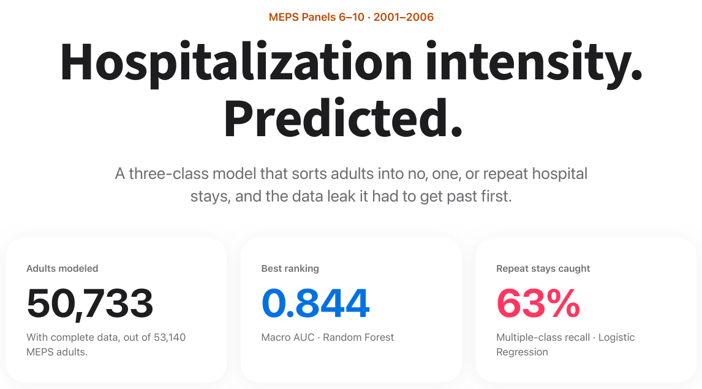
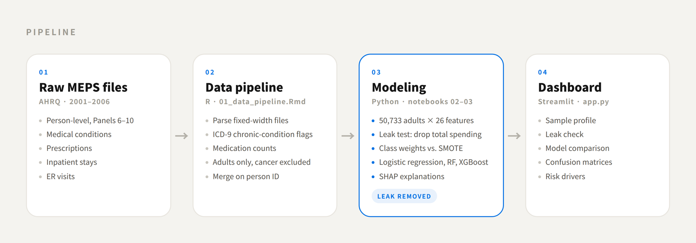
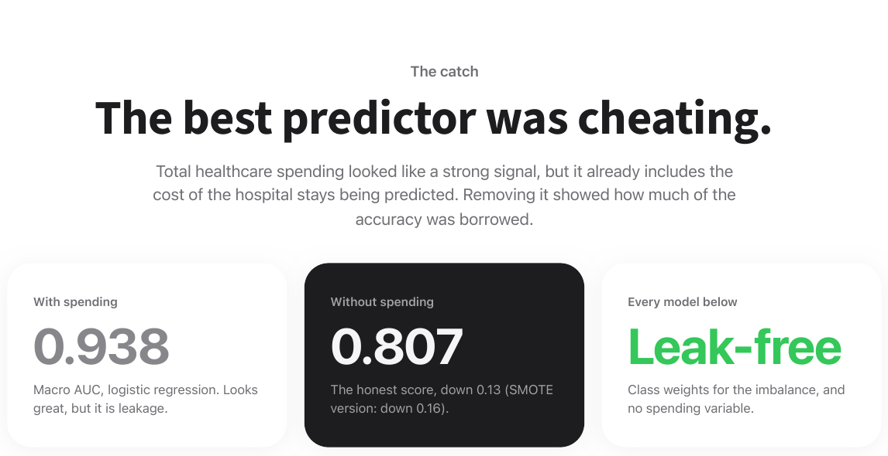
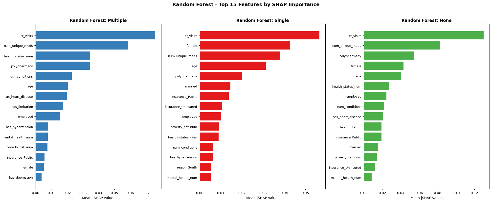

# Predicting Hospitalization Intensity Among U.S. Adults

A three-class model that sorts adults into **no**, **one**, or **multiple** hospital stays, built on
50,733 adults from the Medical Expenditure Panel Survey (MEPS, Panels 6–10, 2001–2006).

**Portfolio write-up:** [sharanv99.github.io](https://sharanv99.github.io)



---

## Why three classes?

Hospital stays are among the costliest events in U.S. healthcare, and one admission is very different
from repeated ones: median spending was about 37 times higher for adults admitted two or more times.
A yes/no model hides that difference, so this project predicts **None / Single / Multiple**.

The classes are very uneven (91.6% / 6.6% / 1.7%), so a model that always says "None" would be
91.6% accurate and useless. Results below focus on **Macro AUC** and **recall for the rare classes**.

## What I did



1. **Built the dataset from raw MEPS files.** Parsed fixed-width files using their SAS layout files, and merged
   five file types per panel: person-level, medical conditions, prescriptions, inpatient stays, and ER visits.
2. **Engineered features:** chronic-condition flags from ICD-9 codes, unique medication counts and a
   polypharmacy flag, plus demographics, insurance, poverty level and self-rated health (26 features in total).
   Adults with cancer diagnoses were excluded.
3. **Caught a data leak.** Total healthcare spending looked like a strong predictor, but it already includes the
   cost of the hospital stays being predicted. Removing it dropped Macro AUC by 0.13–0.16, which showed how much
   of the apparent accuracy was leakage. All final models exclude it.

   

4. **Compared ways to handle imbalance.** SMOTE vs. class weights: class weights caught far more repeat-admission
   patients (62.9% vs. 38.3% recall), without generating synthetic patient records.
5. **Compared three models** (elastic-net logistic regression, Random Forest, XGBoost) and explained them with SHAP.
6. **Built a Streamlit dashboard** to explore the results.

## Results (test set, class weights, no spending variable)

| Model | Macro AUC | Multiple recall | Single recall |
|---|---|---|---|
| Logistic regression (elastic net) | 0.807 | **62.9%** | 37.4% |
| Random Forest | **0.844** | 52.1% | 51.1% |
| XGBoost | 0.828 | 36.5% | **54.5%** |

Numbers are from the notebooks; the dashboard retrains live and may differ by about 1–2 points due to library versions.

No single model wins everything: Random Forest ranks risk best overall, while logistic regression catches the most
repeat-admission patients. Across all models, **ER visits, number of medications, self-rated health, and age** were the
most consistent signals.



## Limitations

- **Same-year timing.** Predictors (such as ER visits) and the outcome come from the same survey year, so this is
  risk stratification, not advance prediction. The natural next step is predicting Year 2 admissions from Year 1 data.
- **No survey weights.** Results describe the MEPS sample; national estimates would need MEPS survey weights.
- **Small rare class.** Only 167 "Multiple" cases in the test set, from a single train/test split.
- **Childbirth stays.** 70% of single-stay adults are female versus 54% overall, likely reflecting childbirth admissions;
  separating pregnancy-related stays from illness-related ones is a natural next step.
- **Older data.** 2001–2006 data uses ICD-9 codes, so findings may not reflect current care patterns.

## Repository structure

```
01_data_pipeline.Rmd            R: load raw MEPS files, build features, save modeling dataset, EDA
02_logistic_regression.ipynb    Leakage test and SMOTE vs. class weights (4 configurations)
03_random_forest_xgboost.ipynb  Random Forest, XGBoost, SHAP, final model comparison
dashboard/app.py                Streamlit dashboard
docs/images/                    Screenshots used in this README
data/README.md                  Which MEPS files to download
```

## How to run

1. Download the MEPS files listed in [`data/README.md`](data/README.md).
2. Knit `01_data_pipeline.Rmd` in RStudio (packages: readr, dplyr, tidyr, ggplot2, knitr, stringr).
   This creates `data/processed/final_for_modeling.csv`.
3. Install Python packages and run the notebooks in order:
   ```
   pip install -r requirements.txt
   ```
   They save model results to `outputs/`.
4. Launch the dashboard from the repository root (it only needs `data/processed/final_for_modeling.csv`;
   it retrains the three models with the notebooks' exact settings, which takes about a minute the first time):
   ```
   python3 -m streamlit run dashboard/app.py
   ```

---

Built by Sharan Venkatesh as a Northeastern University MPS Analytics capstone (Winter 2026).
